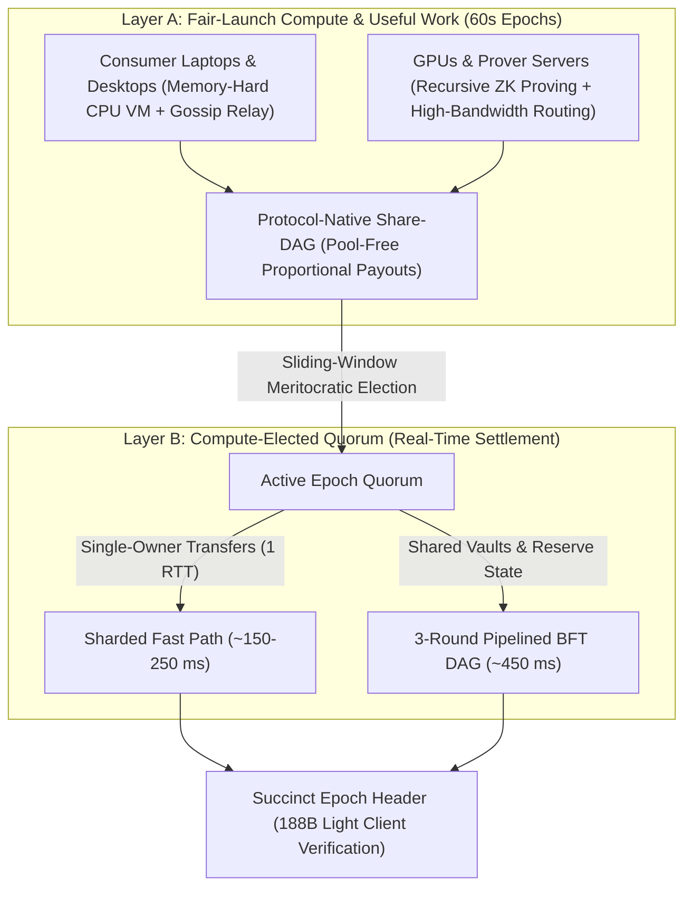

# Credits (`XCR`): Architecture & Monetary Blueprint

**Version:** 0.3 · **Mainnet Genesis Target:** `2027-01-01T00:00:00Z` *(1 January 2027, 00:00 UTC)*

> [!IMPORTANT]
> **Foundational Design Commitments**
> 1. **Phased Monetary Policy:** Launches with scarce, oracle-free disinflationary issuance in Phase 1, then unlocks $\ge 200\%$ over-collateralized **Civilization Basket** Reserve Vaults in Phase 2 once objective network decentralization thresholds are met.
> 2. **Fair Launch (`0` Premine):** Zero premine, venture allocation, or founder reserve. Mainnet `Epoch 0` (`xcr-mainnet-2027`, Unix `1,798,761,600`) unlocks on the first Bitcoin block mined at or after `00:00:00 UTC` on Friday, 1 January 2027.
> 3. **Accessible Compute Scaling:** Welcomes everyday laptops from Day 1 via memory-hard CPU compute and gossip relay, while scaling naturally as GPUs and servers contribute recursive zero-knowledge state proving.
> 4. **Visual Identity:** **Double-Bar V** emblem (`assets/brand/credit-symbol.svg` — representing `∀` *"For All"* and `V` *"Verified Value"*) paired with supranational ticker **`XCR`**.

---

## 1. Comparative Payment System Tradeoffs

| Property | Physical Cash | Card / Bank Rails | Bitcoin (+ LN) | PoS L1 Chains | Monero | Fiat Stablecoins | **Credits (`XCR`)** |
| :--- | :--- | :--- | :--- | :--- | :--- | :--- | :--- |
| **Initial Distribution** | N/A | N/A | Earned from Block 0 | Initial allocations | Earned from Block 0 | Issuer-minted | **Earned from Block 0** |
| **Settlement Finality** | Instant (local) | 1–3 business days | 10–60m L1 / channel | ~0.4s – 2s | ~20m | Chain-dependent | **~150–250 ms deterministic** |
| **Typical Transfer Fee** | Zero | 1.5%–3.5% + \$0.30 | Variable L1 / routing | ~\$0.001–\$0.02 | ~\$0.02 | Chain-dependent | **3 free/day, then ~0.05–0.1¢** |
| **Network Participation** | N/A | Licensed institutions | Specialized ASICs | Stake + server HW | CPU PoW (pools) | Custodial reserve | **Laptop CPUs → ZK Servers (pool-free)** |
| **Custody Model** | Direct bearer | Account custodian | Direct bearer | Direct bearer | Direct bearer | Issuer freeze controls | **Direct bearer (no L1 freeze keys)** |
| **Privacy & Compliance** | Local privacy | Account-identified | Public ledger | Public ledger | Opaque by default | Public ledger | **Default private + ZK Proofs of Innocence** |
| **Purchasing-Power Model** | Tracks local fiat | Tracks local fiat | Fixed supply | Variable issuance | Tail emission | Tracks single fiat | **Phase 1 Scarce → Phase 2 9-Pillar Basket** |

---

## 2. Two-Layer Consensus Architecture

Proof-of-Stake requires an existing token distribution at genesis, whereas traditional Proof-of-Work ties payment confirmation latency to block intervals. **Credits separates Sybil-resistant compute participation from real-time payment finality:**



### Core Protocol Mechanics
1. **CPU Bootstrap & On-Demand ZK Proving:** Consumer machines run a cache-hard virtual machine (`CpuVm`) across configurable background threads (`Eco` / `Balanced` / `Max` or `--threads N`), earning continuous difficulty-weighted rewards (`canonical_cpu_share_weight`), while GPUs and servers earn proportional weight for recursive zero-knowledge proving (`RecursiveZkState`) when transactions are active.
2. **Pool-Free Epoch Share-DAG:** Lower-difficulty shares enter an on-chain DAG directly (retaining up to the top-2 highest-weight proofs per worker per epoch), enabling solo computers to receive steady payouts every 60 seconds without custodial pools.
3. **1-RTT Payment Finality (`~150–250 ms`):** Single-owner transfers lock `(sender, nonce)` and collect quorum finality signatures in a single UDP round-trip.
4. **Closed-Loop `70 / 15 / 15` Micro-Fees:** `70%` rewards current epoch workers, `15%` enters the one-year exponentially releasing `SecurityEndurancePool`, and `15%` is permanently burned.
5. **Stateless Archival & Supermajority Governance:** Accounts inactive for $\ge 2\text{ years}$ compact into a 32-byte Merkle root (`<256-byte` revival proof, zero balance expiration), and protocol upgrades require $\ge 85.00\%$ sustained compute support followed by a 30-day review period.

---

## 3. Symbol, Ticker & Denominations

- **Double-Bar V (`assets/brand/credit-symbol.svg`):** Combines `∀` (`U+2200`, *"For All"*) and `V` (*"Verified Value"*) with parallel currency bars; written by hand in three strokes.
- **Why `XCR`:** Under ISO 4217 conventions, the `X` prefix designates supranational monetary standards not issued by a single state (`XAU`, `XAG`, `XDR`).
- **Integer Sub-Units (`u64`):**
  - `1.000000 XCR` = **1 Credit** (`1,000,000 bits`)
  - `0.010000 XCR` = **1 Chip** (`10,000 bits`)
  - `0.000001 XCR` = **1 Bit** (`1 base unit`)

---

## 4. Workspace Layout (`credit/`)

```text
credit/
├── assets/brand/
│   └── credit-symbol.svg           # Official Double-Bar V vector emblem
├── docs/
│   ├── GETTING_STARTED.md          # Setup guide for Credits Desktop, Wallet, Exchange & Vault
│   ├── WHITEPAPER.md               # End-to-end technical whitepaper
│   ├── BLUEPRINT.md                # Architectural overview & design rationale
│   ├── CONSENSUS_PONC.md           # PoNC, Share-DAG & 1-RTT Fast Path specification
│   ├── ZK_COMPLIANCE.md            # Stealth transfers, Bulletproofs, RingCT & Privacy Pools
│   └── SECURITY.md                 # Safety invariants, constant-time crypto & verification
├── scripts/
│   ├── install-desktop.ps1         # Windows Credits Desktop & shortcut installer
│   ├── publish-desktop-release.ps1 # Offline Curve25519 release signer & publisher
│   └── mainnet-genesis-watcher.py  # Multi-API 2027-01-01T00:00:00Z Bitcoin beacon unlocker
├── swaps/
│   └── CreditAtomicSwap.sol        # Standalone EVM / ERC-20 HTLC atomic swap contract
├── crates/
│   ├── credit-types/               # Fixed-point amounts, 70/15/15 fees, Pocket & Vault state
│   ├── credit-crypto/              # SHA-256, X25519 stealth, Curve25519, Noise AEAD, WOTS+
│   ├── credit-ponc/                # Memory-hard CPU VM & difficulty-scaled Epoch Share-DAG
│   ├── credit-zk/                  # 672B Bulletproofs, light headers, Privacy Pools, ISO-20022
│   ├── credit-consensus/           # 1-RTT Fast Path, sharding, BFT DAG, governance & Reserve Vaults
│   ├── credit-net/                 # XCR1 framing, UDP/QUIC transport, Kademlia DHT & P2P mesh
│   ├── credit-storage/             # Crash-safe XCRWAL01 storage, pruning & cold-archival
│   ├── credit-sdk/                 # CreditWallet SDK, XCRENC01, Shamir/FROST, RingCT & BOLT-11
│   ├── credit-gpu-sys/             # Zero-dep headless Linux OpenCL dlopen bridge for server GPUs
│   ├── credit-node/                # Unified participant node (genesis-status, peer, compact-wal)
│   ├── credit-cli/                 # Command-line wallet, atomic swap & audit client
│   ├── credit-gateway/             # Zero-dependency HTTP/1.1 web wallet, POS & Explorer
│   ├── credit-desktop/             # Native egui + wgpu Multi-Currency Wallet, Exchange & Node
│   └── credit-bench-fuzz/          # Decoder/ZK fuzzers & Byzantine fault test suite
└── Cargo.toml
```
