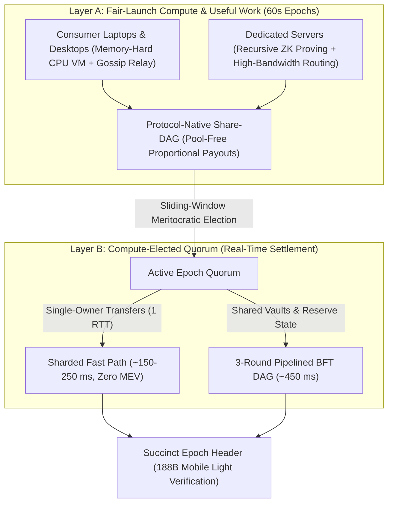

# Credits (`XCR`): Architecture & Monetary Blueprint

**Version:** 0.3 · **Mainnet Genesis Target:** `2027-01-01T00:00:00Z` *(1 January 2027, 00:00 UTC)*

> [!IMPORTANT]
> **Foundational Design Commitments**
> 1. **Phased Monetary Policy (`Option C`):** Launches as scarce, oracle-free sound money in Phase 1, then unlocks $\ge 200\%$ over-collateralized **Civilization Basket** stability in Phase 2 once objective decentralization thresholds are met.
> 2. **100% Fair Launch:** Zero premine, zero venture or founder allocation, zero ICO. Mainnet `Epoch 0` (`xcr-mainnet-2027`, Unix `1,798,761,600`) unlocks on the first Bitcoin block mined at or after `00:00:00 UTC` on Friday, 1 January 2027.
> 3. **Accessible Compute Scaling:** Welcomes everyday laptops from Day 1 via memory-hard CPU compute and gossip relay, while scaling naturally as dedicated servers contribute recursive ZK state proving.
> 4. **Visual Identity:** **Double-Bar V** emblem (`assets/brand/credit-symbol.svg` — encoding `∀` *"For All"* and `V` *"Verified Value"*) paired with supranational ticker **`XCR`**.

---

## 1. Design Tradeoffs Across Payment Systems

| Property | Physical Cash | Card / Bank Rails | Bitcoin (+ LN) | PoS L1 Chains | Monero | Fiat Stablecoins | **Credits (`XCR`)** |
| :--- | :--- | :--- | :--- | :--- | :--- | :--- | :--- |
| **Fair Launch (`0` Premine)** | N/A | N/A | **Yes** | Initial allocations | **Yes** | Custodial IOU | **Yes (earned from Block 0)** |
| **Settlement Finality** | Instant (local) | 1–3 days (net) | 10–60m L1 / channel | ~0.4s – 2s | ~20m | Chain-dependent | **~150–250 ms deterministic** |
| **Typical Transfer Fee** | Zero | 1.5%–3.5% + \$0.30 | Variable L1 / routing | ~\$0.001–\$0.02 | ~\$0.02 | Chain-dependent | **~0.05–0.1¢ target** |
| **Node Participation** | N/A | Closed banking | Specialized ASICs | Stake + server HW | CPU PoW (pools) | Issuer retains yield | **Laptop CPUs → ZK Servers (pool-free)** |
| **Bearer Unfreezability** | **Yes** | No | **Yes** | **Yes** | **Yes** | No (`blacklist()`) | **Yes (zero freeze keys at L1)** |
| **Privacy + Compliance** | Private locally | Full surveillance | Public ledger | Public ledger | Exchange delistings | Public ledger | **Default private + ZK Proofs of Innocence** |
| **Long-Term Purchasing Power** | Fiat inflation | Fiat inflation | Supply-fixed | Supply-variable | Tail emission | Tracks USD inflation | **Phase 1 Scarce → Phase 2 9-Pillar Basket** |

---

## 2. Two-Layer Consensus Architecture

Pure Proof-of-Stake cannot execute a zero-premine fair launch (with zero coins at Genesis, nobody can stake), while traditional Proof-of-Work couples block mining directly to slow transaction confirmation. **Credits separates Sybil-resistant compute participation from real-time payment finality:**



### Five Core Protocol Mechanics
1. **CPU-First Bootstrap → Useful Server Proving:** Consumer machines run a cache-hard virtual machine (`CpuVm`) suited to general-purpose CPUs across configurable background threads (`Eco` / `Balanced` / `Max` or `--threads N`), earning continuous sub-bit difficulty-weighted rewards (`canonical_cpu_share_weight`) proportional to contributed compute, while high-throughput servers also earn Share-DAG weight by generating recursive zero-knowledge state proofs (`RecursiveZkState`).
2. **Pool-Free Epoch Share-DAG:** Lower-difficulty valid shares enter an on-chain DAG directly (retaining up to the top-2 highest-weight proofs per worker per epoch), allowing solo laptops to earn continuous rewards every 60 seconds without centralized mining pools while scaling linearly with multi-core hashpower.
3. **1-RTT Payment Finality (`~150–250 ms`):** Single-owner transfers bypass global ordering queues; validators lock `(sender, nonce)` and co-sign finality certificates in one UDP round-trip.
4. **Closed-Loop `70 / 15 / 15` Micro-Fees:** `70%` rewards current epoch workers, `15%` enters the one-year exponentially dripping `SecurityEndurancePool`, and `15%` is permanently burned—imposing an immediate `30%` loss on wash-spam while pre-funding multi-decade security.
5. **Stateless Archival & Supermajority Governance:** Accounts inactive $\ge 2\text{ years}$ compact out of hot validator RAM into a 32-byte Merkle root (`<256-byte` revival proof, zero confiscation), and protocol upgrades require $\ge 85.00\%$ sustained PoNC compute support plus a 30-day user grace window.

---

## 3. Symbol, Ticker & Denominations

- **Double-Bar V (`assets/brand/credit-symbol.svg`):** Combines `∀` (`U+2200`, *"For All"*) and `V` (*"Verified Value"*) with parallel currency bars; written by hand in three strokes.
- **Why `XCR`:** Under ISO 4217 conventions, the `X` prefix designates supranational monetary standards not issued by a single state (`XAU`, `XAG`, `XDR`), avoiding the legacy hardware ambiguity of `VCR`.
- **Integer Sub-Units (`u64`):**
  - `1.000000 XCR` = **1 Credit** (`1,000,000 bits`)
  - `0.010000 XCR` = **1 Chip** (`10,000 bits`)
  - `0.000001 XCR` = **1 Bit** (`1 base unit`)

---

## 4. Workspace Layout (`credit/`)

```text
credit/
├── assets/brand/
│   └── credit-symbol.svg        # Official Double-Bar V vector emblem
├── docs/
│   ├── GETTING_STARTED.md       # Plain-English beginner guide for Credits Desktop & Vault
│   ├── WHITEPAPER.md            # Formal end-to-end technical whitepaper
│   ├── BLUEPRINT.md             # Architectural overview & design rationale
│   ├── CONSENSUS_PONC.md        # PoNC, Share-DAG & 1-RTT Fast Path specification
│   ├── ZK_COMPLIANCE.md         # Stealth transfers, Bulletproofs, RingCT & Privacy Pools
│   └── SECURITY.md              # Safety invariants, constant-time crypto & fuzzing
├── scripts/
│   ├── install-desktop.ps1      # 1-click Windows Credits Desktop & shortcut installer
│   └── mainnet-genesis-watcher.py # Multi-API 2027-01-01T00:00:00Z Bitcoin beacon unlocker
├── swaps/
│   └── CreditAtomicSwap.sol     # Standalone EVM / ERC-20 HTLC atomic swap counterpart
├── crates/
│   ├── credit-types/            # Fixed-point amounts, 70/15/15 fees, Pocket & Vault state
│   ├── credit-crypto/           # SHA-256, X25519 stealth, Curve25519, Noise AEAD, WOTS+
│   ├── credit-ponc/             # Memory-hard CPU VM & difficulty-scaled Epoch Share-DAG
│   ├── credit-zk/               # 672B Bulletproofs, light headers, Privacy Pools, ISO-20022
│   ├── credit-consensus/        # 1-RTT Fast Path, sharding, BFT DAG, governance & Reserve Vaults
│   ├── credit-net/              # XCR1 framing, UDP/QUIC transport, Kademlia DHT & P2P mesh
│   ├── credit-storage/          # Crash-safe XCRWAL01 storage, contract pruning & cold-archival
│   ├── credit-sdk/              # CreditWallet SDK, XCRENC01, Shamir/FROST, RingCT & BOLT-11
│   ├── credit-node/             # Unified participant node (genesis-status, peer, compact-wal)
│   ├── credit-cli/              # Command-line wallet, atomic swap & audit client over UDP
│   ├── credit-gateway/          # Zero-dependency HTTP/1.1 web wallet, POS, JSON-RPC & Explorer
│   ├── credit-desktop/          # Optional native egui Desktop Wallet & 1-click background miner
│   └── credit-bench-fuzz/       # Decoder/ZK fuzzers & Byzantine adversary test suite
└── Cargo.toml
```
